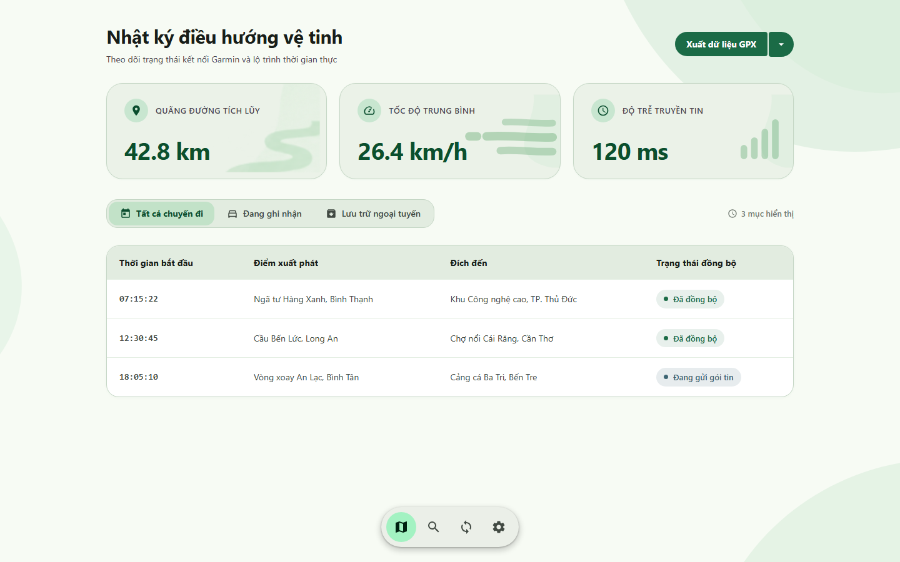

# Material 3 Expressive Skill (`m3-expressive-skill`)

Bộ quy chuẩn thiết kế và tài nguyên kỹ thuật dành cho AI Coding Agents (Antigravity IDE, Claude Code, Cursor, Windsurf, Copilot, Cline) và lập trình viên nhằm xây dựng giao diện chuẩn **Google Material Design 3 Expressive (2024+)** trên Web, Android Jetpack Compose và Flutter.

<p align="center">
  
</p>

---

## 1. Cài đặt vào AI Coding Assistant

### Cách 1: Cài đặt vào Antigravity IDE (Khuyến nghị)

#### Cài đặt toàn cục (Global - Dùng cho mọi dự án)
Clone hoặc sao chép thư mục skill vào thư mục cấu hình toàn cục của Antigravity:
```powershell
# Windows PowerShell
git clone https://github.com/dangphuc2470/m3-expressive-skill.git "$HOME\.gemini\config\skills\m3-expressive-skill"
```

#### Cài đặt theo từng Workspace (Dự án riêng lẻ)
Tạo thư mục `.agents/skills/` ngay tại thư mục gốc của repository dự án và clone vào:
```powershell
# Tại thư mục gốc của dự án của bạn
git clone https://github.com/dangphuc2470/m3-expressive-skill.git ".agents\skills\m3-expressive-skill"
```

---

### Cách 2: Cài đặt vào Claude Code

Copy hoặc clone vào thư mục skills của Claude:
```bash
# Global
git clone https://github.com/dangphuc2470/m3-expressive-skill.git ~/.claude/skills/m3-expressive-skill

# Hoặc theo từng repository
git clone https://github.com/dangphuc2470/m3-expressive-skill.git .claude/skills/m3-expressive-skill
```

---

### Cách 3: Tích hợp vào Cursor / Windsurf / GitHub Copilot

Thêm chỉ dẫn đọc skill vào file rule của công cụ:

#### Cho Cursor (`.cursorrules` hoặc `.cursor/rules/m3.mdc`):
```markdown
Whenever designing or implementing UI, adhere strictly to the Material 3 Expressive specifications defined in:
- Path to skill: `path/to/m3-expressive-skill/SKILL.md`
- Multi-platform tokens: `path/to/m3-expressive-skill/tokens/`
- Component rules: `path/to/m3-expressive-skill/references/component-specs.md`
- Anti-patterns: `path/to/m3-expressive-skill/references/anti-patterns.md`
```

#### Cho Copilot (`.github/copilot-instructions.md`):
```markdown
Follow the design guidelines and token systems in `m3-expressive-skill/SKILL.md` for any Web, Compose, or Flutter UI tasks.
```

---

## 2. Tích hợp trực tiếp vào Source Code Dự án

Nếu bạn muốn nhúng sẵn design tokens và components vào codebase dự án:

### Web (Vanilla HTML/CSS, React, Vue, Next.js, Svelte)
1. Copy file [tokens/tokens.css](tokens/tokens.css) vào thư mục styles của dự án (ví dụ `src/styles/tokens.css`).
2. Nhúng vào file CSS chính hoặc file HTML:
   ```html
   <link rel="stylesheet" href="./styles/tokens.css">
   ```
3. Sử dụng các biến CSS chuẩn:
   ```css
   .metric-card {
     background-color: var(--md-sys-color-surface-container-lowest);
     border: 1px solid var(--md-sys-color-outline-variant);
     border-radius: var(--md-sys-shape-corner-large);
     transition: all var(--md-sys-motion-duration-short4) var(--md-sys-motion-easing-emphasized);
   }
   ```

### Flutter
1. Copy [tokens/tokens.dart](tokens/tokens.dart) vào thư mục `lib/core/theme/tokens.dart`.
2. Copy [examples/flutter/theme.dart](examples/flutter/theme.dart) và [components.dart](examples/flutter/components.dart) vào dự án.
3. Cấu hình `MaterialApp`:
   ```dart
   MaterialApp(
     theme: M3AppTheme.lightTheme,
     darkTheme: M3AppTheme.darkTheme,
     themeMode: ThemeMode.system,
     home: const HomeScreen(),
   );
   ```

### Android Jetpack Compose
1. Copy [tokens/Tokens.kt](tokens/Tokens.kt) vào package theme của bạn (ví dụ `com.yourpackage.ui.theme`).
2. Tham khảo các mẫu component và shape morphing trong [examples/compose/](examples/compose/).
3. Kích hoạt `MaterialTheme`:
   ```kotlin
   MaterialTheme(
       colorScheme = LightColorScheme,
       shapes = Shapes,
       content = content
   )
   ```

---

## 3. Cấu trúc Thư mục

```text
m3-pro/
├── SKILL.md                          # Tài liệu chỉ dẫn chính cho AI Agent
├── README.md                         # Hướng dẫn cài đặt và tích hợp
├── tokens/                           # Tokens chuẩn hóa đa nền tảng
│   ├── tokens.json                   # W3C Design Tokens JSON
│   ├── tokens.css                    # CSS Custom Properties (Web)
│   ├── tokens.dart                   # Constants cho Flutter
│   └── Tokens.kt                     # Constants cho Jetpack Compose
├── references/                       # Bộ tài liệu quy chuẩn chuyên sâu
│   ├── anti-patterns.md              # Nhận diện lỗi thiết kế & AI slop
│   ├── component-specs.md            # Kích thước vật lý, touch target 48dp, padding
│   ├── screen-archetypes.md          # Blueprint Dashboard, Form, List, Adaptive
│   ├── color-system.md               # Hệ thống 5 tầng Surface Container & HCT
│   ├── corner-radius-and-shapes.md   # Thang bo góc & 35 hình Expressive
│   ├── motion-physics.md             # Động học lò xo & Easing curves
│   ├── typography.md                 # Quy chuẩn phân cấp kiểu chữ
│   ├── component-catalog.md          # Danh mục linh kiện Expressive 2024
│   └── responsive-adaptive.md        # Layout đa kích thước màn hình
└── examples/                         # Mã nguồn mẫu chạy thực tế
    ├── flutter/                      # Theme & Components cho Flutter
    ├── compose/                      # Theme, Shapes & Components cho Android Compose
    └── web/                          # Demo Dashboard HTML/CSS tương tác thực tế
```

---

## 4. Cách Kích hoạt AI sử dụng Skill

Khi chat với AI Agent trong bất kỳ tác vụ thiết kế hoặc code UI nào:
- Kêu nó: *"Áp dụng skill m3-pro để thiết kế màn hình này..."* hoặc *"Đọc m3-pro/references/screen-archetypes.md để dựng layout..."*.
- Agent sẽ tự động tham chiếu các file quy chuẩn, lấy đúng thông số kích thước, màu sắc và cấu trúc hình học mà không chế bậy linh tinh.
